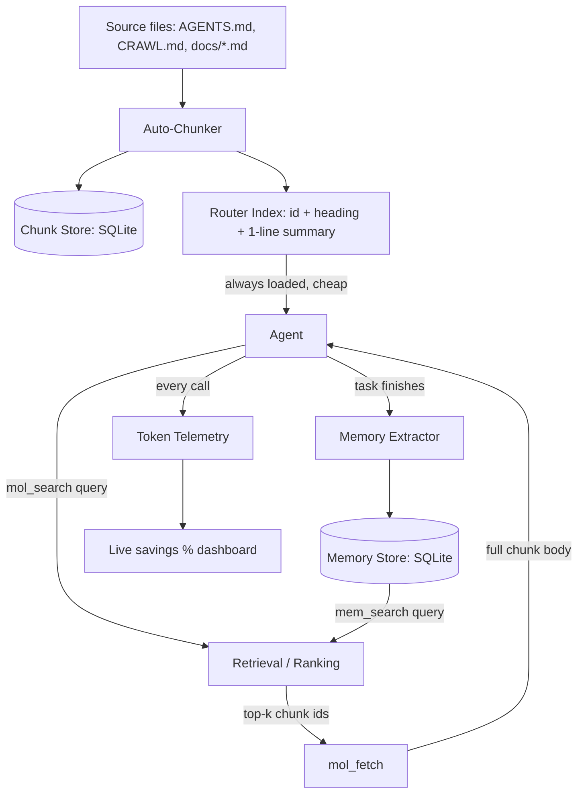

# AGENTS.md — Project: Molecule

> **Read this whole file before writing a single line of code.**
> This is the single source of truth for what this project is, why it exists, what already
> exists in the world (so we don't rebuild it by accident), and exactly how to build the MVP.
> If anything in a future prompt conflicts with this file, this file wins unless the human
> explicitly says otherwise.

---

## 1. One-paragraph pitch

Molecule is a small, pluggable module that gives any AI agent two things at once: (a) it
**automatically breaks a big, messy instruction file** (`AGENTS.md`, `CRAWL.md`, a wiki export,
whatever) **into small labeled chunks** and only hands the agent the one chunk it actually
needs for the current task, and (b) it **remembers small facts across sessions** (decisions,
corrections, preferences) the same lightweight way. It ships as an MCP server, so it plugs
into Claude Code, Cursor, a custom LangChain/CrewAI agent, or other development agents with
the same three or four tool calls.

Plain-language version: instead of an agent reading the whole textbook every session to
answer one question, it reads the table of contents (cheap), picks the one chapter it needs
(cheap), and only then opens that chapter (the only "expensive" read). And it keeps a small
notebook of things worth remembering, so it doesn't ask the same question twice.

---

## 2. The problem, in plain terms

Two separate pains, usually treated as two separate tools. We're combining them on purpose.

**Pain A — no memory across sessions.** Every new chat/agent run starts blank. The user has
to re-explain preferences, past decisions, and project state every time.

**Pain B — wasted reading of big context files.** A large `AGENTS.md`/`CRAWL.md`/README gets
read in full, every session, even when the task only needs one paragraph of it. This burns
tokens (tokens = the small text chunks an LLM is billed and limited by — roughly like words)
on content that never gets used.

---

## 3. What already exists — do NOT rebuild these, build on the gap between them

| Tool | What it actually solves | What it does NOT solve |
|---|---|---|
| **Mem0** (open source, 59k+ GitHub stars) | Fact memory: extracts durable facts from a conversation, stores them, retrieves the relevant few next time. `add()` / `search()` API. | Does nothing with large static instruction files. No chunking of docs. |
| **Letta / MemGPT** | Tiered memory (core / recall / archival), OS-style memory management for agents. | Same gap — built for conversational memory, not doc-splitting. |
| **Official MCP Memory server** | Knowledge-graph style fact storage (entities, relations, observations) over MCP. | Same gap again. Also no automatic chunking of source files. |
| **Claude Skills / "progressive disclosure"** | Solves Pain B — but only if a **human hand-writes** each `SKILL.md` file and its one-line description. | No automatic chunking of an existing messy file. No fact-memory layer. Manual authoring doesn't scale to a 5,000-line doc someone already has. |
| **Megas Moves** (friend's product) | Shared project state + task queue + mobile app for teams working with coding agents. | Different target (multi-person project management, closed beta app), not a drop-in library/MCP server a solo dev can embed in five minutes. |

**The actual gap:** nobody automatically turns an *existing, already-messy* file into the
chunked, labeled, on-demand structure that Skills requires humans to hand-build — and nobody
combines that with a lightweight memory layer in one small package. That's what Molecule is.

---

## 4. Novelty & Core Value Proposition

> "Everyone else makes you choose: hand-write your Skills files, or bolt on a memory API.
> We point Molecule at the messy docs you already have, and it does the chunking, the
> labeling, the routing, and the remembering — automatically, and it proves the savings
> with a live number."

The **live token-savings counter** (see §11) is the single most important thing to build
well — it's the part that visually and quantitatively demonstrates optimization benefits.

---

## 5. Architecture



Everything is local-first (SQLite file, no required external DB) so Molecule is fully self-contained and operates without internet connectivity or external latency.

---

## 6. Core modules

### 6.1 Auto-Chunker
- Parse the source markdown by heading structure (H1/H2/H3 = natural chunk boundaries).
- If a section is bigger than `MAX_CHUNK_TOKENS` (default 400), split further on sentence
  boundaries with a small overlap (~1 sentence) so meaning doesn't get cut mid-thought.
- If a section is smaller than `MIN_CHUNK_TOKENS` (default 50), merge it into its sibling
  under the same parent heading.
- For each final chunk, generate a short label ("table-of-contents line") with a single
  cheap LLM call, batched. Cache the label by `content_hash` so unchanged sections are
  never re-summarized.
- Support an explicit `always_include: true` marker (e.g. a YAML front-matter flag or an
  HTML comment) for critical guardrails that must load every time no matter what (example:
  "never touch the production database").

### 6.2 Router / Selective Retrieval
- On session start, load only the **router index**: chunk id, heading path, one-line
  summary, token count. This is the cheap "table of contents" step.
- On a task/query, embed the query, rank chunks (and memories) by similarity, return the
  top `k` (default 3–5) plus anything flagged `always_include`.
- Only the selected chunks' full bodies are fetched into context.

### 6.3 Session Memory Store
- After a task completes, run one summarization pass over the transcript: "extract up to 5
  durable facts worth remembering long-term, one sentence each, skip anything ephemeral."
- Store each fact with an embedding, a confidence score, source task id, and timestamp.
- Before storing, check similarity against existing memories to avoid duplicate/near-duplicate
  entries (dedup threshold, e.g. cosine similarity > 0.92 → skip or merge).
- Optional `expires_at` for facts that shouldn't live forever (e.g. "currently debugging X").

### 6.4 MCP Tool Interface
Expose exactly these tools (keep the surface small on purpose):

```python
from mcp.server.fastmcp import FastMCP
mcp = FastMCP("molecule")

@mcp.tool()
def mol_load_index() -> list[dict]:
    """Return the cheap router index: id, heading_path, summary, token_count."""

@mcp.tool()
def mol_search(query: str, k: int = 5) -> list[dict]:
    """Return ranked chunk/memory candidates (ids + summaries only, not full bodies)."""

@mcp.tool()
def mol_fetch(chunk_ids: list[str]) -> list[dict]:
    """Return the full body text for the given chunk ids."""

@mcp.tool()
def mem_write(text: str, source_task: str, confidence: float = 0.8) -> dict:
    """Store a new durable fact."""

@mcp.tool()
def mem_search(query: str, k: int = 5) -> list[dict]:
    """Retrieve relevant stored memories."""

@mcp.tool()
def mol_ingest(file_path: str, force: bool = False) -> dict:
    """(Re)chunk a source file. Skips unchanged sections unless force=True."""

@mcp.tool()
def mol_stats() -> dict:
    """Return token telemetry: tokens_used_this_session, tokens_if_full_file_loaded, savings_pct."""
```

**Added post-MVP (implemented):**

```python
@mcp.tool()
def mol_feedback(chunk_id: str, useful: bool, query: str = "") -> dict:
    """Self-learning router: report whether a fetched chunk was useful.
    Adjusts a bounded learned_weight (EMA, clamp 0.5–1.5) that multiplies
    into ranking. Guardrail (always_include) chunks can drop in rank but
    are never dropped from results."""

@mcp.tool()
def mol_feedback_stats() -> dict:
    """What the router has learned: vote counts + per-chunk learned weights."""

@mcp.tool()
def mem_extract(transcript: str, source_task: str = "session") -> dict:
    """Auto memory extraction: pull up to 5 durable facts from a transcript
    heuristically (no LLM call). Direct statements → 0.9 confidence, hedged
    → 0.6, ephemeral → task_state with 7-day expiry. Each fact flows through
    mem_write (redaction/dedup/conflict for free)."""
```

### 6.5 Token-Savings Telemetry
- Track, per session: tokens actually sent to the model vs. what would have been sent if the
  full source file(s) were dumped in every time.
- Expose via `mol_stats()` and render as a simple running percentage to provide clear visibility into cost and latency savings.

---

## 7. Data model (SQLite)

```sql
CREATE TABLE chunks (
  chunk_id TEXT PRIMARY KEY,
  source_file TEXT,
  heading_path TEXT,       -- JSON array, e.g. ["Architecture","Database Layer"]
  summary TEXT,
  content TEXT,
  token_count INTEGER,
  content_hash TEXT,
  always_include BOOLEAN DEFAULT 0,
  embedding BLOB,
  last_updated TEXT
);

CREATE TABLE memories (
  memory_id TEXT PRIMARY KEY,
  text TEXT,
  source_task TEXT,
  confidence REAL,
  embedding BLOB,
  created_at TEXT,
  expires_at TEXT
);

CREATE TABLE session_telemetry (
  session_id TEXT,
  tokens_used INTEGER,
  tokens_baseline INTEGER,
  ts TEXT
);
```

---

## 8. Tech stack decisions (and why)

- **Python 3.10+** — Standard developer environments, fastest path to build clean and reusable code.
- **MCP Python SDK / FastMCP** — Official pattern, works across Claude Code, Cursor, and custom agents with no adapter code.
- **SQLite (+ a vector extension like `sqlite-vec` or pure Python fallback)** — Zero external services, single local file. Molecule works completely offline for data privacy, speed, and network resilience.
- **Embeddings**: Default to a small local model (e.g. `sentence-transformers` all-MiniLM) for offline execution; allow swapping to cloud embeddings via a config flag for production flexibility.
- **tiktoken** (or equivalent) for token counting to accurately measure cost and latency reduction.

---

## 9. Non-goals (explicit scope fence — do not build these for MVP)

- Not a full agent framework. We are a memory + context layer, nothing else.
- Not trying to replace Mem0/Letta for general-purpose conversational memory at scale.
- No GUI, no mobile app, no multi-user team sync (that's Megas Moves' lane, not ours).
- No cloud hosting requirement — local-first by default. Cloud sync can be a future feature, not a build target.

---

## 10. Build plan / milestones

**Phase 1 — Chunker + storage.** Parse markdown, produce chunks, store in SQLite, generate labels, cache by hash. Test on your own `AGENTS.md` and other documentation files.

**Phase 2 — MCP interface + retrieval.** Wire up all seven tools above. Get `mol_load_index` → `mol_search` → `mol_fetch` working end to end against a real agent (start with a simple script, then Claude Code or Cursor).

**Phase 3 — Memory layer.** Add `mem_write` / `mem_search`, the extraction pass, and dedup logic.

**Phase 4 — Telemetry + polish.** Token saving tracking, a clean developer README, verification walkthrough, and a labeled test set for the retrieval quality check.

---

## 11. Verification and Reference Walkthrough

1. **Baseline pain**: Run a task with the full source file dumped into the prompt every turn. Show the token counter climbing.
2. **Molecule on**: Run the same task. Show the router loading (~100 tokens), the one relevant chunk being fetched (~300–400 tokens), and the active savings percentage on screen.
3. **Cross-session recall**: Restart the process. Ask something that depends on an earlier decision. Show the agent answering correctly without being re-told.
4. **Portability proof**: Plug the same MCP server into two different agents (e.g., Claude Code and a plain LangChain script) to prove the "one module, works anywhere" claim.

---

## 12. Retrieval Performance and Speed Benchmarks

- Build a small labeled test set: 20 example task queries, each with the "correct" chunk id a human picked by hand. Measure router precision — target ≥ 80% top-3 accuracy.
- Measure re-chunking speed on a 5,000-line doc — target under 5 seconds for a full rebuild, under 1 second for an incremental (changed-section-only) update.
- Measure and log real token savings across at least 3 different realistic tasks.

---

## 13. Known risks + mitigations

| Risk | Mitigation |
|---|---|
| Chunk boundaries cut a thought in half | Heading-based splitting first, sentence-boundary + overlap as fallback only |
| Embedding calls are slow/flaky in production | Default to a local embedding model; cloud model is an optional flag |
| Router picks the wrong chunk | `always_include` escape hatch for must-have guardrails; keep k configurable; log misses for the eval set |
| Memory layer stores noisy/duplicate facts | Confidence threshold + similarity-based dedup before writing |
| Storing secrets or raw code accidentally in memory | Simple redaction pass (strip anything matching common secret patterns) before `mem_write` persists |

---

## 14. Coding conventions for any agent working on this repo

- Python 3.10+, type hints required on all public functions.
- `pytest` for tests, `ruff` for lint — both must pass before a change is considered done.
- Keep the MCP tool functions thin; put real logic in a separate `core/` package so it's testable without spinning up an MCP server.
- Store the local DB at `.molecule/store.db` relative to the target repo — same idea as a `.git` folder, invisible until you look for it.
- Never let `mem_write` persist raw secrets or full file contents — summaries and facts only.

---

## 15. Definition of Done for Core MVP

- [ ] Can ingest a real 5,000-line markdown file and produce a sane chunk index in under 5s
- [ ] Router hits ≥ 80% top-3 precision on the 20-query labeled test set
- [ ] `mol_stats()` shows a live, accurate, non-cherry-picked savings percentage
- [ ] Server runs standalone and has been tested against at least 2 different agent clients
- [ ] Memory persists correctly across a full process restart
- [ ] README + reference walkthrough (§11) fully validated

## 16. Improvements

Here you go — short and practical, one line of "what to actually build" per point:

**1. Update instead of piling up**
When saving a new memory, first run `mem_search` against old ones. If similarity is high AND the new note contradicts the old one (quick keyword/negation check, or one cheap LLM call: "do these conflict? yes/no"), mark the old row `status = 'replaced'` instead of deleting it — keep history, just stop using it in searches.

**2. Confidence score**
Add a `confidence` column (already in your schema). Rule of thumb: direct statement ("I hate green") = 0.9+, inferred from behavior = 0.5–0.6. When writing, tag which type it was. Only auto-trust ≥0.7 without asking; below that, surface it back to the user once ("should I remember this?").

**3. Expiry**
Add `expires_at` (already planned) + a `type` field: `preference` (no expiry) vs `task_state` (expires in X days, e.g. 7). One small cleanup function that runs on startup: delete/hide anything past `expires_at`.

**4. Exact match + meaning match together**
Don't rely only on embeddings. Add a plain SQLite `LIKE`/keyword search alongside your vector search, run both, merge and re-rank the results (simple score: `0.7 * embedding_score + 0.3 * keyword_match`). Cheap to add, big accuracy boost.

**5. Explain the pick**
When `mol_search`/`mem_search` returns a result, include a `reason` field in the response (`"matched keyword: button, similarity: 0.91"`). Log it, and optionally print it during your demo — free "wow, it's not a black box" moment.

**6. Weight important rules higher**
Reuse your `always_include` flag — extend it to memories too, plus add a `weight` column (default 1.0, guardrails = 2.0+). Multiply into the ranking score so high-weight memories surface even with a so-so similarity score.

**7. Periodic tidy-up**
A scheduled job (run every N ingests, or on startup): find memory clusters with similarity > 0.85, send them to one LLM call — "merge these into one clean sentence" — replace the group with the merged note.

**One-line summary:** each of these is just one new column + one small check, not a new system — add them to the tables you already planned in AGENTS.md section 7, one at a time.

**Status update (implemented):** items 1–6 are live. Retrieval is now
`(0.6·embedding + 0.3·BM25-lite + 0.15·heading-match) × weight × learned_weight`,
where `learned_weight` comes from `mol_feedback` votes (bounded EMA). Chunks embed
heading path + summary + content together (versioned via `embedding_text_version`
— old DBs auto re-embed on next ingest, learned weights preserved). `mem_extract`
implements the §6.3 extraction pass without requiring an LLM. BM25 and heading
match additionally expand query tokens into generic concept-cluster siblings
(`core/expansion.py`, reduced weight, no LLM) — paraphrased queries hit 12/12 on
the adversarial eval set while the main set stays 20/20. The hot search path is
memoized per connection (`core/cache.py`), invalidated automatically on writes.


## 17. Keeping it Lightweight and Robust

These are standing rules for the whole build, not a one-time task. Any code touching chunks/memories must follow these:

### Stay Lightweight

- **Use a small local embedding model** (e.g. `all-MiniLM-L6-v2`, ~80MB, runs on CPU) as the default. Cloud embeddings are opt-in only, never required to run the project.
- **Never re-embed text** you've already embedded. Check `content_hash` first; only compute a new embedding on an actual change.
- **Store embeddings as plain float32 arrays** directly inside the same SQLite file — no separate vector database needed at this scale.
- **Skip fancy ANN/FAISS-style indexes** for MVP. Brute-force similarity search is fast enough under ~10k rows; only add an index if real usage proves you need it.
- **Run the periodic dedup/merge job** (§6.3) so the notebook doesn't grow unbounded — fewer rows means faster search and less to store, for free.

### Stay Robust

- **New memories that conflict** with an existing one update/replace it (`status='replaced'`) instead of piling up duplicates.
- **Confidence score**: Every memory carries a confidence score; low-confidence guesses should not silently override things the user stated directly.
- **Time-bound facts** (`task_state`) get an `expires_at`; only true preferences live forever.
- **Retrieval combines** exact keyword match + embedding similarity — don't rely on "sounds similar" alone.
- **Explain the pick**: Every retrieval result carries a short `reason` field — never return a match with no explanation of why it was picked.

### Stay Fast

- **Router index load** (`mol_load_index`) must stay near-instant — it's cheap by design, keep it that way; never let it accidentally load full chunk bodies.
- **Incremental re-ingest** (only changed sections) should be the default path; full rebuilds are a fallback, not the normal case.

> [!TIP]
> **Rule of thumb before adding anything new to this module**: If a feature adds a network call, a new dependency, or a bigger index just to handle a scale this project will never reach, leave it out of the MVP and note it under future work instead.