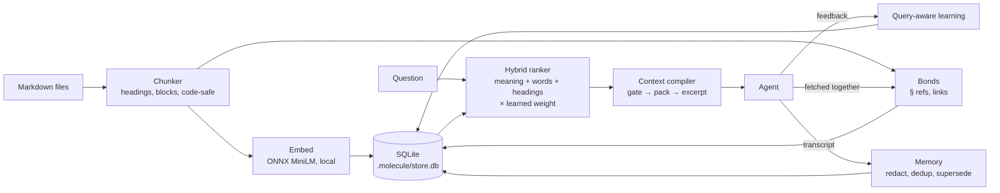

# Molecule

**A local context layer for AI agents: it hands the agent the right part of your docs, within a token budget, and remembers what it learned — offline, in one SQLite file.**

```python
from molecule import Molecule

mol = Molecule()                     # ./.molecule/store.db
mol.ingest("docs/")                  # once — edits are picked up automatically

ctx = mol.context("how do we roll back a bad deploy?", budget=400)
print(ctx["context"])                # only the sections that answer it, never over 400 tokens
```

Works as an **MCP server** (tested with the official MCP client; the Claude Code and Cursor setup below is documented but not yet tested end to end) and as a **Python library** (LangChain, CrewAI, your own agent). No API keys, no cloud, no PyTorch.

---

## The problem, in one picture

An agent that works on your project needs the project's rules: `AGENTS.md`, a wiki export, a docs folder. Today it has two bad options:

- **Read everything, every time.** Thousands of tokens per question, most of them irrelevant. You pay for all of it, and the useful part gets lost in the noise.
- **Hand-write small "skill" files** so the agent can load just one. That does not scale to the 5,000-line document you already have.

And every new session starts from zero: the agent forgets the decisions and preferences you told it yesterday.

Molecule is the third option. Think of a textbook: you do not re-read the whole book to answer one question — you look at the table of contents, open one chapter, and keep a notebook of things worth remembering. Molecule does that for the agent, automatically, and proves the savings with a counter that counts every token it hands out.

---

## Results

All numbers come from `python benchmarks/run_benchmarks.py` (real model, fresh store each time) — full tables in [`benchmarks/RESULTS.md`](benchmarks/RESULTS.md). "0.1 → 0.2" compares the previous release with this one on identical questions.

**Finding the right section** (top-3 = the right section is among the first three results)

| Questions | 0.1 | 0.2 |
|---|---|---|
| **Blind test** — reworded questions about a document nothing was tuned on | 42.3% | **88.5%** |
| Reworded questions, held-out handbook | 54.2% | **87.5%** |
| Direct questions (all three documents) | 100% | **100%** (top-1 also 100%) |
| Reworded questions about `AGENTS.md` (the set 0.1 was tuned on) | 100% | 91.7% |

"Reworded" means the question shares almost no words with the answer — *"what does the unit do by itself when the base station stops answering"* has to find the section called *Radio link*. That is the hard case, and where 0.1 failed most.

**Spending tokens**

| | |
|---|---|
| Tokens per question with `mol_context(budget=300)` | **227** instead of 5,631 for the whole handbook (−96%), 10/10 answered |
| `mol_context` vs. "fill the budget with top results" | answers within 2 points, up to **47% fewer tokens** |
| Two-part questions fully answered: no bonds → cross-reference bonds → + co-fetch learning (1,200-token budget) | 5/8 → 7/8 → **8/8** |
| Budget overruns, across every benchmark run | **0** |

**Learning from feedback** — top-1 accuracy after an agent voted on 24 hard questions

| | before | query-aware (0.2) | one weight per section (0.1) |
|---|---|---|---|
| The same needs, reworded (never voted on) | 62.5% | **91.7%** | 83.3% |
| Questions about other topics (must not get worse) | 87.5% | **87.5%** | 83.3% ↓ |

**Speed** (4-core cloud VM, CPU only)

| | |
|---|---|
| Index a 5,000-line document (227 chunks) | 4.2 s on the first test machine; 5.3–5.5 s on a later one |
| Re-index after editing one section | 0.14 s |
| Search / `mol_context` for a new question | 3.0 ms / 3.1 ms (p50, embedding included) |
| Cold start, new process → first answer | 0.69 s |

---

## Quick start

```bash
pip install -e ".[dev]"     # Python 3.10+
molecule setup              # one-time: download the embedding model (~90 MB) for offline use
molecule ingest AGENTS.md   # or a whole folder: molecule ingest docs/
molecule context "how does the chunker split big sections?" --budget 400
```

### Claude Code / Cursor (MCP)

Add to `~/.claude/settings.json` (Claude Code) or `.cursor/mcp.json` (Cursor):

```json
{
  "mcpServers": {
    "molecule": {
      "command": "molecule",
      "args": ["serve"],
      "cwd": "/absolute/path/to/your/repo"
    }
  }
}
```

The server tells the agent how to use it; the short version is: **call `mol_context` with the question.** Works with both major versions of the MCP Python SDK (1.x and 2.x — both tested).

### No download at all

`MOLECULE_EMBEDDING_MODEL=hashing` switches to a built-in embedder that needs no model file. It is weaker on reworded questions but fine on direct ones, and it is what the test suite uses so tests run anywhere in seconds.

---

## The tools

| Tool | What it does | Cost |
|---|---|---|
| **`mol_context(query, budget)`** | Best context for the question, ready to paste, never over budget | The one call most agents need |
| `mol_load_index(max_tokens, prefix)` | Table of contents that always fits the budget | ~60–400 tokens |
| `mol_search(query, k)` | Ranked ids + one-line summaries + *why* + related sections | No bodies |
| `mol_fetch(chunk_ids)` | Full text of chosen sections | Only what you ask for |
| `mol_feedback(chunk_id, useful, query)` | Teach the router; the lesson sticks to similar questions | Free |
| `mol_feedback_stats()` | What it has learned: weights and learned links | Free |
| `mem_write` / `mem_search` | Store and recall a fact | Cheap |
| `mem_extract(transcript)` | Pull up to 5 durable facts out of a conversation (no LLM) | Cheap |
| `mol_forget` / `mem_merge_duplicates` | Delete one memory / merge near-duplicates | Free |
| `mol_ingest(path)` / `mol_sync()` | Index a file or folder / re-index whatever changed | Incremental |
| `mol_list_sources` / `mol_remove_source` | Manage indexed files | Free |
| `mol_stats()` | Tokens used vs. loading the files — session and lifetime | Free |
| `mol_health()` / `mol_eval(queries)` | Status and latency / measure routing accuracy | Free |

Every search result carries a `reason` (`"similarity: 0.62, keyword: 0.63, heading match: 0.05"`) and a `relevance` label. **`relevance: "low"` means "the docs probably do not cover this"** — the agent should not trust that match.

---

## How it works



1. **Chunking.** Markdown is cut at headings (H1–H3). A `# comment` inside a code block is not a heading. A section that is too long is split between paragraphs, list items, table rows or code lines — never in the middle of one — and a split table keeps its header row, a split code block is re-fenced. Tiny sections join their neighbour. Every chunk gets a one-line label read from its structure (lead sentence, table first column, function names, bold phrases).

2. **Ranking.** Each section gets three scores, combined:

   ```
   score = (0.6 × meaning + 0.6 × keywords + 0.15 × heading) × learned
   ```

   - *meaning*: cosine similarity of embeddings (`all-MiniLM-L6-v2`, run with ONNX Runtime).
   - *keywords*: BM25, with stemming ("deploying" = "deploy"), stopwords dropped, "roll back" matching "rollback", and synonyms from small concept groups at reduced weight. Normalised as **coverage** — "how much of this question does the section explain" — not as "relative to the best section" (see below for why that matters).
   - *heading*: share of question words in the section title.
   - *learned*: feedback weight between 0.5 and 1.5, specific to the question.

3. **Context compiler** (`mol_context`). Rank → keep only sections scoring within 60% of the best one → pack them whole, best first → cut the first one that overflows → list the rest under `omitted`. Near-copies are skipped; a section the text links to ("see §7.3") is let in at half the bar. Guardrail sections (`<!-- always_include -->`) always come first.

4. **Memory.** Every fact passes the same gate: secrets redacted → near-duplicates skipped → a contradiction retires the old fact (kept as history, linked to its replacement) → short-term facts expire after 7 days. The notebook is capped; the least valuable facts are evicted first.

---

## What is new here

Each idea below is something the benchmark measures; [`docs/ARCHITECTURE.md`](docs/ARCHITECTURE.md) has the details and the experiments that did *not* make it.

1. **Coverage-normalised keyword scoring.** The usual hybrid recipe scales BM25 so the best document scores 1.0. That gives a weak, one-word match full volume and drowns out meaning on reworded questions. Dividing by what the *question* could score instead (its total word rarity) keeps keywords loud when the wording matches and quiet when it does not. This change, plus stemming and stopwords, is most of the 54% → 88% jump.

2. **A context compiler instead of a fetch tool.** The agent asks once with a budget and gets the answer material back, guaranteed to fit. The budget is a ceiling, not a target: the compiler stops when the remaining sections are not close to the best one, which is where the "same answers, 47% fewer tokens" comes from.

3. **Query-aware feedback.** 0.1 kept one weight per section, so a section that helped with *deploy* questions got boosted for *every* question. Now each vote remembers its question as a vector, and counts in proportion to how similar today's question is (a kernel on cosine similarity, replayed as a bounded moving average). Rewordings of a taught question gain; other topics are untouched.

4. **Bonds between sections.** Explicit links ("see §7.3", `[Rollback](#rollback)`, links to other files) are parsed at ingest. Sections an agent fetches together are linked by a Hebbian rule (`s ← s + 0.2·(1 − s)`) that fades with a 30-day half-life. Search results show `related` sections, and the compiler pulls them in when there is room.

5. **Calibrated "I don't know".** Rank scores are only comparable within one question. A separate absolute evidence score (meaning + half the keyword coverage) labels each result high / medium / low. Thresholds were set on one document and checked on two others.

6. **Honest accounting.** `mol_stats` counts *every* token returned — table of contents, search results, memories, contexts — and counts each source file once per session as the baseline. 0.1 only counted fetched chunks, which hid the cost of searching. The benchmark shows plainly that the step-by-step path does not pay off on small files; `mol_context` does.

## Built to run unattended

- **Offline by default.** The model is looked up in the local cache first; the tokenizer vocabulary loads lazily, with a built-in estimator if it is missing. 0.1 needed the network just to *import*.
- **No PyTorch.** The same MiniLM model runs on ONNX Runtime (identical vectors, cosine 1.0000): ~80 MB of dependencies instead of 1–5 GB, and a ~0.3 s model load instead of ~4 s. PyTorch remains optional for models without an ONNX export.
- **Atomic, incremental ingest.** One transaction per file: a crash leaves the previous index intact. Unchanged files are skipped by hash; in a changed file only the edited sections are re-embedded. A renamed heading keeps what the router learned about it.
- **Self-describing index.** Every vector is tagged with the model that made it; each file records the settings it was built with. Change the model or the chunk size and the affected parts rebuild themselves — vectors from two different models are never compared.
- **Cache that cannot go stale.** SQLite triggers bump a counter per table on every write; the search cache keys on those counters. Writes from another process, or raw SQL, invalidate it; bookkeeping writes do not.
- **Versioned migrations.** `PRAGMA user_version` steps, each in one transaction; stores from 0.1 upgrade in place with their data and learned weights.
- **Always fresh.** Before a read, edited source files are re-indexed (one cheap `stat()` per file, at most every 5 s).
- **Thread-safe engine.** One lock per instance; the MCP server and the CLI are thin wrappers over the same `Molecule` object.
- **Operable.** `molecule doctor` checks integrity, schema, model, stale or deleted sources and names the fix. `mol_health` reports per-operation latency (p50/p95). `molecule export`/`import` move memories, votes and learned links between machines as plain JSON; `molecule backup` copies the live store safely.
- **Tested.** 391 tests, hermetic by default (built-in embedder, no network), plus real-model accuracy gates and an end-to-end test that drives `molecule serve` with the official MCP client over stdio. `python verify_efficiency.py` checks every item of the project's Definition of Done.

---

## Python API

```python
from molecule import Molecule, MoleculeConfig

with Molecule(root="/path/to/repo") as mol:
    mol.ingest("AGENTS.md")                      # file or folder
    mol.context("question", budget=600)          # {"context", "items", "omitted", "confidence", ...}
    mol.index(max_tokens=400)                    # table of contents that fits
    hits = mol.search("question", k=5)           # ids + summaries + reason + relevance + related
    mol.fetch([hits[0]["id"]])                   # full text
    mol.feedback(hits[0]["id"], useful=True, query="question")

    mol.remember("Deploys never go out on Fridays", confidence=0.9)
    mol.recall("when can we deploy?")
    mol.extract(transcript_text)                 # up to 5 facts, no LLM call
    mol.memory_history(memory_id)                # how a decision changed over time

    mol.stats()                                  # session + lifetime savings, by kind
    mol.doctor(); mol.health(); mol.sync()
    mol.evaluate(labeled_queries, ablate=True)
    mol.export_snapshot("molecule-snapshot.json"); mol.backup("store-backup.db")
```

More examples (LangChain, CrewAI, a plain agent loop) in [`INTEGRATION.md`](INTEGRATION.md).

## CLI

```
molecule setup | ingest PATH | sync [--prune] [--watch N] | sources | remove FILE
molecule context "Q" [--budget N] | search "Q" [-k N] | index [--max-tokens N] | bonds ID
molecule feedback ID [--useful/--not-useful] [--query Q] | feedback-stats
molecule extract FILE | merge | export FILE | import FILE | backup FILE
molecule stats | health | doctor | eval FILE [--ablate] | serve
```

Most commands take `--json`.

## Configuration

Defaults < `.molecule/config.json` < environment. **Any** setting can be set as `MOLECULE_<NAME>` (for example `MOLECULE_CONTEXT_BUDGET=800`). Invalid values are reported and ignored, never fatal.

| Setting | Default | What it does |
|---|---|---|
| `embedding_model` | `all-MiniLM-L6-v2` | Any sentence-transformers model with an ONNX export, or `hashing` |
| `context_budget` | 1200 | Default token budget for `mol_context` |
| `context_min_score_ratio` | 0.6 | How close to the best section a section must score to be included |
| `context_excerpt` | `head` | How an overflowing section is cut: `head`, or `focus` (most relevant sentences) |
| `index_token_budget` | 400 | `mol_load_index` always fits in this |
| `emb_weight` / `keyword_weight` / `heading_boost` | 0.6 / 0.6 / 0.15 | Ranking mix |
| `relevance_high` / `relevance_low` | 0.45 / 0.25 | Thresholds for the relevance label |
| `max_chunk_tokens` / `min_chunk_tokens` | 400 / 50 | Split above / merge below |
| `chunk_embed_tokens` | 256 | How much of each section the embedding reads |
| `passage_vectors` | false | Also embed every sentence (≈ +1 point top-3, ≈ 5× slower ingest) |
| `feedback_kernel_floor` / `_full` | 0.3 / 0.85 | Question similarity where a vote starts / fully applies |
| `bond_half_life_days` | 30 | How fast learned links fade without use |
| `auto_sync` | true | Re-index edited files before reads |
| `max_active_memories` | 5000 | Notebook size cap |
| `cost_per_mtok_usd` | 3.0 | Price used for the "$ saved" estimate |

The full list, with comments, is in [`src/molecule/config.py`](src/molecule/config.py).

## Mark rules that must always load

```markdown
## Production safety
<!-- always_include -->
Never run destructive commands against production without a second person.
```

Or `always_include: true` in YAML front matter for a whole file. Guardrails are included first in every `mol_context`, appended to every search, and can never be removed by feedback. The marker itself is not shown to the agent.

---

## Testing and benchmarks

```bash
make check                              # ruff + 391 tests (incl. real-model accuracy gates)
python verify_efficiency.py             # Definition of Done, item by item (9 checks)
python benchmarks/run_benchmarks.py     # every table in benchmarks/RESULTS.md
python demo.py                          # the two-minute tour
```

Benchmarks use three documents: this repo's `AGENTS.md` and a made-up engineering handbook (both used while tuning), and firmware notes written after tuning was frozen and scored once — the blind test. Answer labels are phrases that must appear in the returned text, so the comparison stays fair when the chunker changes.

## Limits, honestly

- **Near-topic questions fool the "I don't know" label.** "What is our parental leave policy?" against an engineering handbook often scores `medium`: it *sounds* like the document. Clearly unrelated questions are always flagged.
- **Rank 1 on reworded questions is still hard** (42% on the blind set; 88% within the top 3). Read the top three, or let `mol_context` do it.
- **Small files.** Below a few thousand tokens, loading the whole file once per session may be cheaper than many step-by-step searches; the savings table says so plainly.
- **English.** The stemmer, stopwords and synonym groups are English; other languages fall back to meaning-only ranking.
- **One writer at a time.** SQLite in WAL mode lets many readers and one writer share the store; it is built for one developer's machine, not a shared server.

## Project structure

```
src/molecule/
  engine.py        Molecule: the one public object (lock, freshness, accounting, learning hooks)
  server.py        MCP server — 18 thin tools
  cli.py           molecule command — thin wrapper
  config.py        typed settings: defaults < config.json < MOLECULE_* env
  db.py            SQLite: connections, migrations, generation-counter triggers
  core/
    markdown.py    fence-aware block, sentence, list and table splitting
    chunker.py     headings → sections → block-aware split → merge
    labeler.py     one-line labels from structure (no LLM)
    normalize.py   tokenizer: stopwords + light stemmer
    expansion.py   concept-cluster synonyms
    scoring.py     coverage-normalised BM25, heading match, compound words
    embedder.py    ONNX / torch / hashing backends, model-tagged vectors
    ingest.py      atomic incremental ingest, sources, directory walk
    retriever.py   hybrid ranking, relevance labels, budget-fit index
    context.py     the budgeted context compiler
    bonds.py       cross-reference and Hebbian co-fetch links
    feedback.py    query-aware bounded-EMA learning
    memory.py      redact → dedup → supersede → expire → evict
    extractor.py   facts from transcripts (no LLM)
    telemetry.py   honest token accounting
    sync.py · snapshot.py · doctor.py · metrics.py · eval.py · cache.py · tokens.py
benchmarks/        corpora, labeled queries, run_benchmarks.py, RESULTS.md
tests/             391 tests
```

## Non-goals

Not an agent framework. Not a replacement for Mem0 or Letta for large-scale chat memory. No GUI, no multi-user sync, no cloud requirement.

## License

MIT
